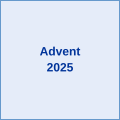

<!-- murlspace: a place for code -->
<!-- GitHub's sidebar already shows your photo, name, status, bio and links, so this page is the right-hand side of the profile. -->
<!-- When your Krita logo is ready, save the whole masthead as banner.png in the bars folder and change bars/banner.svg to bars/banner.png below. -->

<b>Meryl has 8 friends.</b>

<table>
<tr>
<td align="center"><a href="https://github.com/KinnearM/fft"> fft</a></td>
<td align="center"><a href="https://github.com/KinnearM/Orbital_GIF_Machine"> Orbital_GIF_Machine</a></td>
<td align="center"><a href="https://github.com/KinnearM/NR-data-reader"> NR-data-reader</a></td>
<td align="center"><a href="https://github.com/KinnearM/Advent_2025"> Advent_2025</a></td>
</tr>
<tr>
<td align="center"><a href="https://github.com/KinnearM/boosted-trumpet-initial-data-GR24"> GR24 poster 🏆</a></td>
<td align="center"><a href="https://github.com/KinnearM/Honoursproject"> Honoursproject</a></td>
<td align="center"><a href="https://github.com/KinnearM/penrose-diagrams"> penrose-diagrams</a></td>
<td align="center"><a href="https://github.com/octocat"> Tom</a></td>
</tr>
</table>

div>

<!------!>
