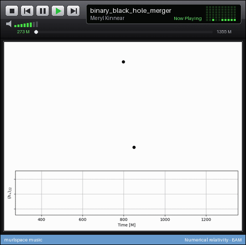
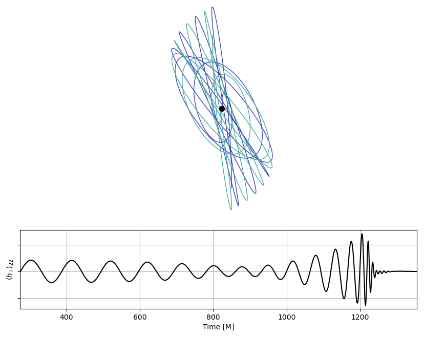
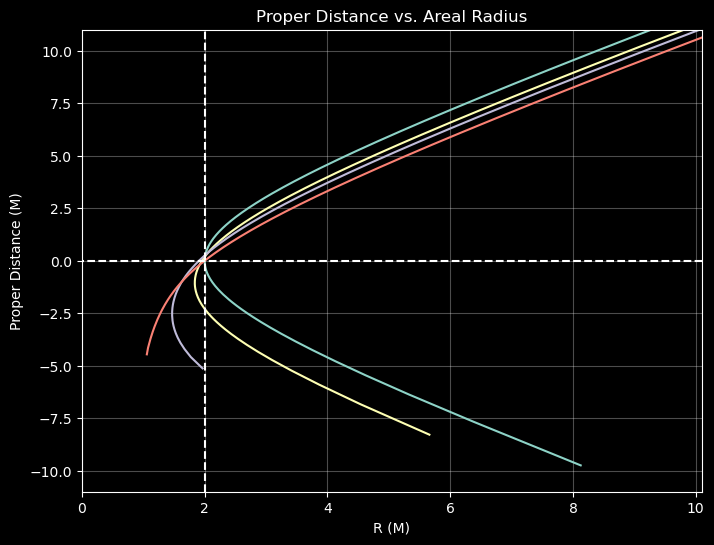
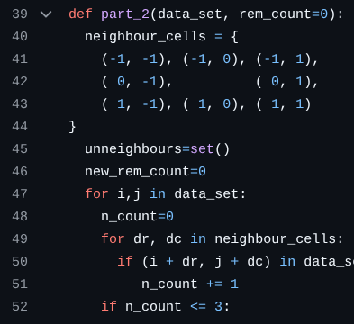
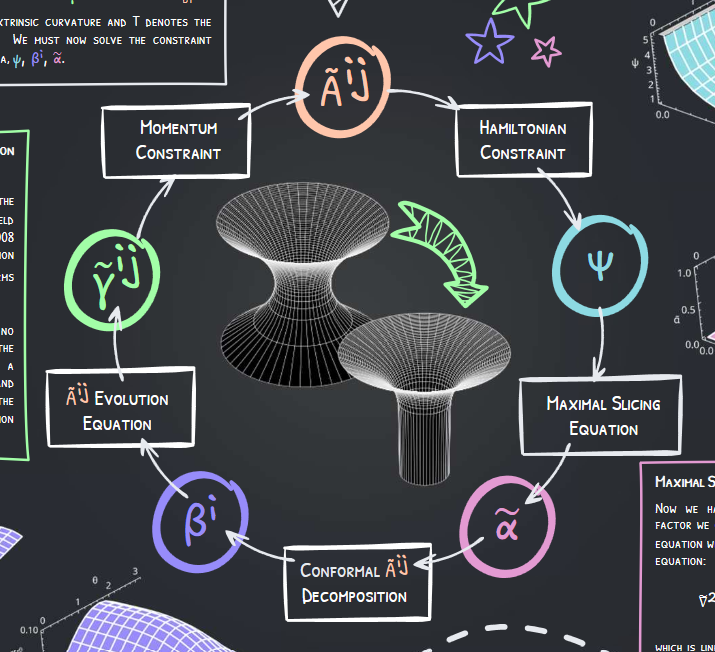
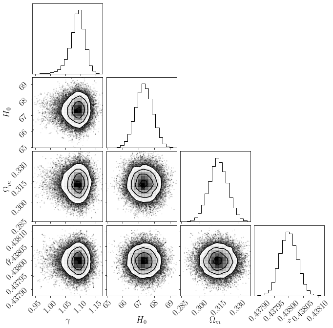
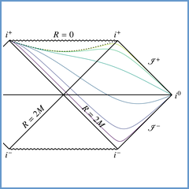

<!-- murlspace: a place for code -->

 

 

 

Profile views: 

 

<b>Meryl has 8 friends.</b>

<table>
<tr>
<td align="center"><a href="https://github.com/KinnearM/fft">fft </a></td>
<td align="center"><a href="https://github.com/KinnearM/Orbital_GIF_Machine">GIF Machine </a></td>
<td align="center"><a href="https://github.com/KinnearM/NR-data-reader">NR reader </a></td>
<td align="center"><a href="https://github.com/KinnearM/Advent_2025">Advent 2025 </a></td>
</tr>
<tr>
<td align="center"><a href="https://github.com/KinnearM/boosted-trumpet-initial-data-GR24">GR24 poster 🏆 </a></td>
<td align="center"><a href="https://github.com/KinnearM/Honoursproject">Honours Project </a></td>
<td align="center"><a href="https://github.com/KinnearM/penrose-diagrams">Penrose Diagrams </a></td>
<td align="center"><a href="https://github.com/octocat">Tom </a></td>
</tr>
</table>

